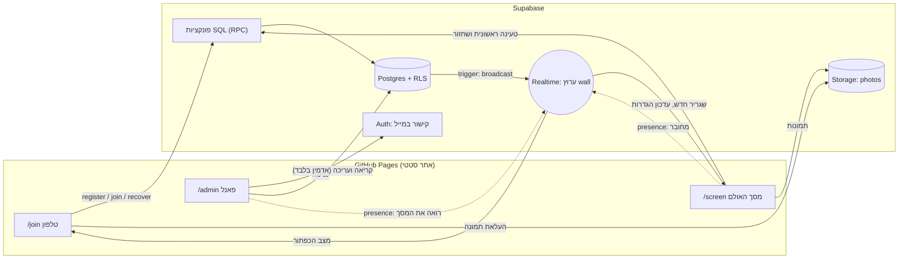

# מסמך אפיון טכני: נבחרת השגרירים

> גרסה 1.0 · 22.11.2026 · משלים את `docs/SPEC.md` (מה בונים) ומתאר איך בונים. ההדמיות ב-`docs/design/` הן נקודת המוצא לקוד של המסכים.

## 1. עקרונות

- **פשוט ובטוח לערב אחד.** כ-150 משתמשים, ערב אחד, צוות קטן. בוחרים טכנולוגיה מוכרת ומנוהלת, בלי שרת משלנו.
- **אין שרת אפליקציה.** אתר סטטי מדבר ישירות עם Supabase. כל הלוגיקה הרגישה יושבת בתוך מסד הנתונים (פונקציות SQL והרשאות ברמת השורה).
- **פרטים אישיים לא יוצאים מהשרת לציבור.** המסך והטלפונים מקבלים רק שם, יישוב ותמונה. טלפון ומייל נגישים רק לאדמין.
- **המסך באולם לא נופל.** כל רכיב במסך מתאושש לבד מניתוק, ותמיד אפשר לשחזר את הקיר מהשרת.

## 2. טכנולוגיות

| שכבה | בחירה | למה |
|---|---|---|
| שפה | TypeScript | בדיקת טיפוסים בלי מחיר בזמן ריצה |
| בנייה | Vite, מצב multi-page | שלושה עמודים נפרדים, בנייה מהירה, פלט סטטי |
| ממשק | DOM ו-CSS נקיים, בלי פריימוורק | המסכים קטנים, והקיר הוא אנימציה מותאמת אישית שעובדת ישירות על אלמנטים (כמו בהדמיה) |
| מפה | `d3-geo` ו-`topojson-client`, רק בזמן בנייה | מפת ישראל ונקודות היישובים מחושבות מראש לקובץ JSON, והדפדפן לא טוען ספריית מפות |
| צד שרת | Supabase (תוכנית חינמית) | Postgres, אחסון תמונות, Realtime ו-Auth במקום אחד |
| לקוח שרת | `@supabase/supabase-js` v2 | |
| אחסון האתר | GitHub Pages, פריסה עם GitHub Actions | חינמי, נפרס אוטומטית מכל מיזוג ל-main |
| בדיקות | Vitest (לוגיקה), Playwright (מסלול מלא), סקריפט עומס ב-Node | |

גופנים: Heebo ו-Frank Ruhl Libre, נשמרים בריפו (self-hosted) כדי שהמסך לא יהיה תלוי ב-Google Fonts בזמן האירוע.

## 3. ארכיטקטורה



### זרימת ההצטרפות, מקצה לקצה

1. הטלפון קורא ל-`join_wall(token)`.
2. הפונקציה מסמנת `joined_at`, נותנת מספר סידורי (`join_seq`) ומחזירה אותו. קריאה חוזרת לא משנה כלום (idempotent).
3. טריגר על הטבלה שולח הודעת broadcast לערוץ `wall` עם השם, היישוב, נתיב התמונה ו-`join_seq` בלבד.
4. מסך האולם מקבל את ההודעה, מכניס אותה לתור האנימציות ומציג.
5. אם המסך פספס הודעה (ניתוק), הוא מזהה פער ב-`join_seq` וטוען מחדש את מה שחסר.

## 4. מבנה הריפו

```
/
├─ index.html             → הפניה ל-/join
├─ join/index.html        → מסכי הטלפון
├─ screen/index.html      → מסך האולם
├─ admin/index.html       → פאנל האדמין
├─ src/
│  ├─ shared/             → supabase client, טיפוסים, נרמול טלפון, פונט וצבעים
│  ├─ join/               → טופס, מצלמה, חיתוך תמונה, אחסון מקומי
│  ├─ screen/             → layout של הטבעות, אנימציות, תור, מפה, אורות, חיבור
│  └─ admin/              → טבלה, עריכה, שליטה, ייצוא CSV
├─ public/
│  ├─ brand/              → לוגואים, גופנים
│  └─ geo/                → israel.json (נתיב המפה), cities.json (יישובים וקואורדינטות)
├─ scripts/
│  ├─ build-geo.ts        → מייצר את קובצי ה-geo מ-Natural Earth ומרשימת היישובים
│  ├─ load-test.ts        → 150 הרשמות והצטרפויות מקבילות
│  └─ purge-photos.ts     → מחיקת תמונות אחרי האירוע
├─ supabase/
│  ├─ migrations/         → סכמה, RLS, פונקציות, טריגרים
│  └─ seed.sql            → נתוני פיתוח
├─ tests/                 → Vitest ו-Playwright
└─ docs/                  → SPEC, TECH, הדמיות
```

## 5. מודל הנתונים

### `participants`

| עמודה | סוג | הערות |
|---|---|---|
| `id` | uuid, מפתח | |
| `full_name` | text, חובה | 2 עד 60 תווים |
| `phone` | text, חובה, ייחודי | מנורמל לפורמט `+9725XXXXXXXX` |
| `email` | text, חובה | |
| `city` | text, חובה | שם יישוב מתוך `cities.json` |
| `photo_path` | text | נתיב ב-Storage, ריק אם אין תמונה |
| `photo_hidden` | boolean, ברירת מחדל false | אדמין הסתיר את התמונה, מוצגים ראשי תיבות |
| `wall_hidden` | boolean, ברירת מחדל false | אדמין הסיר מהמסך לגמרי |
| `consent_at` | timestamptz, חובה | מתי סומנה ההסכמה |
| `token_hash` | text, חובה | גיבוב של הקוד הסודי שנשמר בטלפון |
| `registered_by` | uuid | אם נרשם מטלפון של משתתף אחר |
| `joined_at` | timestamptz | מתי לחץ על הכפתור |
| `join_seq` | integer, ייחודי | המספר הסידורי על הקיר |
| `is_simulated` | boolean, ברירת מחדל false | שגרירים מדומים של הסימולציה |
| `created_at`, `updated_at` | timestamptz | |

### `settings` (שורה אחת)

| עמודה | הערות |
|---|---|
| `join_open` | פתוח או נעול עד אות מהבמה. ברירת מחדל: פתוח |
| `wall_epoch` | עולה באחד בכל איפוס, כדי שמסך שמחובר ידע לנקות את עצמו |

### `admin_emails`

רשימת כתובות המייל המורשות. הפונקציה `is_admin()` בודקת שהמשתמש המחובר נמצא בה.

### `wall_entries` (view)

`join_seq`, `full_name`, `city`, כתובת התמונה (או null אם מוסתרת), `joined_at`, `is_simulated`. רק מי שהצטרף ולא הוסר מהמסך. זה כל מה שהמסך רואה.

## 6. הרשאות וממשק

לגולשים בלי התחברות (anon) אין שום גישה ישירה לטבלאות. כל הפעולות עוברות דרך פונקציות `security definer`:

| פונקציה | מי | מה |
|---|---|---|
| `register(name, phone, email, city, consent, photo_path, registered_by_token?)` | כולם | יוצרת משתתף, או מעדכנת אם הטלפון קיים. מחזירה `id` וקוד סודי חדש (`token`) |
| `set_photo(token, photo_path)` | בעל הקוד | החלפת תמונה |
| `join_wall(token)` | בעל הקוד | הצטרפות, idempotent. נכשלת בנימוס כש-`join_open` כבוי |
| `recover(phone)` | כולם | "כבר נרשמתי": מחזירה קוד חדש למספר הקיים |
| `me(tokens[])` | בעל הקוד | השם, היישוב, התמונה והמצב של המשתתפים שבטלפון |
| `wall_since(seq)` | כולם | שורות `wall_entries` אחרי מספר מסוים, לשחזור המסך |

לאדמין המחובר (`is_admin()`) יש גישת קריאה וכתיבה לטבלאות, ופונקציות נוספות: `admin_join(id)`, `admin_reset_wall()`, `admin_simulate(count)`.

**הגבלות:** בדיקת תקינות לכל שדה בתוך הפונקציות, ומגבלת קצב פשוטה ל-`register` ול-`recover` (לא יותר מ-10 קריאות לדקה מאותו טלפון).

**הסיכון של `recover`:** מי שיודע מספר טלפון של מישהו אחר יכול לצרף אותו לנבחרת. זה מקובל לאירוע סגור, האדמין יכול להסיר, ואין חשיפה של פרטים.

### אחסון תמונות

- דלי `photos` עם קריאה ציבורית. שמות הקבצים הם UUID אקראי ואי אפשר לנחש אותם.
- anon יכול רק להעלות קובץ חדש (לא לעדכן ולא למחוק), JPEG בלבד, עד 300KB.
- אדמין יכול להעלות, להחליף ולמחוק.

## 7. Realtime

- **ערוץ `wall` (broadcast מתוך מסד הנתונים):** הטריגר על `participants` שולח `entry` (שגריר חדש או עדכון שם, תמונה, הסתרה), `reset` (איפוס) ו-`settings` (שינוי מצב הכפתור). אין בהודעות טלפון או מייל.
- **המסך:** בטעינה קורא ל-`wall_since(0)`, ואחר כך מאזין לערוץ. על כל הודעה בודק רצף. אם יש חור או אחרי חיבור מחדש, קורא ל-`wall_since(last_seq)`.
- **הטלפונים:** מאזינים רק ל-`settings`, כדי לפתוח את הכפתור לבד כשהוא נעול.
- **Presence:** המסך מכריז על עצמו בערוץ, והאדמין מציג נקודה ירוקה או אדומה לפי זה.
- **עומס:** 150 חיבורים בו-זמנית, מתחת למכסה של התוכנית החינמית (200).

## 8. מסך הטלפון: פרטים טכניים

- **זיהוי:** אחרי `register` הטלפון שומר ב-`localStorage` רשימה של `{id, token}` (אפשר כמה משתתפים בטלפון אחד). אם ה-`localStorage` לא זמין (גלישה בסתר), עובדים מהזיכרון, והמסלול "כבר נרשמתי" משחזר.
- **מצלמה:** `getUserMedia` עם המצלמה הקדמית ומסגרת עגולה. אם אין הרשאה או אין תמיכה, עוברים ל-`<input type="file" accept="image/*" capture="user">`, שעובד בכל טלפון.
- **עיבוד תמונה בטלפון:** `createImageBitmap` עם תיקון סיבוב, חיתוך לריבוע ממורכז, הקטנה ל-600×600, JPEG באיכות 0.82 (בערך 80 עד 120KB). ההעלאה מתחילה כבר כשהמשתמש ממלא את שאר הפרטים.
- **יישובים:** `cities.json` נטען פעם אחת (בערך 1,200 יישובים, כ-40KB) ומשמש להשלמה האוטומטית.
- **רטט:** `navigator.vibrate` במסך "ברוך הבא", כשהדפדפן תומך (אנדרואיד).
- **טלפון:** נרמול של `05X-XXXXXXX`, `+972` ו-`972` לפורמט אחד, בבדיקה גם בטלפון וגם בשרת.

## 9. מסך האולם: פרטים טכניים

- **בסיס הקוד:** ההדמיה `docs/design/wall-demo.html` מפורקת למודולים: `layout` (חישוב הטבעות), `queue` (תור ההופעות), `settle` (אנימציית הכבידה), `map`, `lights`, `connection`.
- **חישוב הטבעות:** פונקציה טהורה `layoutRings(n, width, height) → slots[]`, עם בדיקות יחידה. כל טבעת חייבת להיכנס במלואה למסך, והחלק העליון מוסתר רק על ידי הכותרת.
- **ביצועים:** תנועה עם `transform` ולא עם `left/top`, כדי שהדפדפן ישתמש בכרטיס הגרפי. תמונות נטענות מראש (`decode()`) לפני שמופיעות בזרקור. יעד: 60 פריימים לשנייה עם 100 עיגולים.
- **תור:** הופעה אחת בכל פעם. זמן הזרקור מתקצר מ-1.6 שניות עד 0.45 שנייה ככל שהתור מתארך.
- **מסך מלא ומניעת כיבוי:** כפתור "התחל הקרנה" שעושה `requestFullscreen` ו-`navigator.wakeLock`, ומסתיר את הסמן.
- **מצב חזרה:** `?demo=1` מריץ סימולציה מקומית בלי שרת, לחזרות ולבדיקת המקרן.
- **רזולוציה:** הכל ביחידות יחסיות לגובה ולרוחב, כך שזה נראה אותו דבר ב-1080p וב-4K.

## 10. פאנל האדמין: פרטים טכניים

- **כניסה:** Supabase Auth עם קישור במייל (magic link). אחרי הכניסה בודקים `is_admin()`, ומי שלא ברשימה רואה "אין הרשאה".
- **רשימה:** טעינה מלאה (עד כמה מאות שורות) ועדכון חי דרך `postgres_changes`, שמותר רק לאדמין לפי ה-RLS.
- **ייצוא CSV:** נוצר בדפדפן, UTF-8 עם BOM כדי שאקסל יקרא עברית, בלי שגרירים מדומים.
- **איפוס:** מחייב להקליד "אפס". מאפס את `joined_at` ו-`join_seq`, מוחק את המדומים ומעלה את `wall_epoch`.
- **רישום ידני:** אותו טופס כמו בטלפון, עם צילום ממצלמת המחשב או העלאת קובץ.

## 11. פריסה וסביבות

- **Supabase:** פרויקט אחד. המיגרציות בריפו (`supabase/migrations`) ומוחלות עם Supabase CLI. מפתח ה-`anon` ציבורי ויושב בקוד, מפתח ה-`service_role` לא נכנס לריפו ולא לדפדפן.
- **GitHub Actions:** בכל PR: בדיקת טיפוסים, Vitest ובנייה. בכל מיזוג ל-main: בנייה ופריסה ל-GitHub Pages.
- **כתובות:** `/join` (מקוד ה-QR), `/screen`, `/admin`. קוד ה-QR נוצר מראש כקובץ להדפסה.
- **שמירת נתונים:** תמונות נמחקות ב-2.2.2027 עם `scripts/purge-photos.ts` (או `pg_cron`). פרטי הקשר נשמרים.

## 12. בדיקות

| סוג | מה נבדק |
|---|---|
| יחידה (Vitest) | נרמול טלפון, `layoutRings` (אין חפיפות, כל טבעת בתוך המסך, עד 150), תור ההופעות, ייצוא CSV |
| מסד נתונים | anon לא קורא טלפון ומייל, `join_wall` idempotent, `recover`, מגבלת קצב |
| מסלול מלא (Playwright) | הרשמה עם תמונה, הצטרפות, הופעה על המסך תוך 2 שניות, הסתרת תמונה מהאדמין |
| עומס | `scripts/load-test.ts`: 150 הרשמות ואז 150 הצטרפויות בתוך 30 שניות. המסך מציג את כולן, בלי כפילויות ובלי חורים |
| ידני | אייפון ואנדרואיד (ספארי, כרום, דפדפן וואטסאפ), המקרן באולם, ניתוק אינטרנט באמצע |

## 13. סדר הבנייה

| תאריך | שלב | תוצר |
|---|---|---|
| 23.11 | תשתית | ריפו עם Vite ו-TypeScript, פריסה ל-Pages, פרויקט Supabase, מיגרציה ראשונה (טבלאות, RLS, פונקציות), קובצי geo |
| 24–25.11 | הטלפון | ששת המסכים, מצלמה ועיבוד תמונה, הרשמה, הצטרפות ושחזור |
| 25–27.11 | מסך האולם | פירוק ההדמיה לקוד, חיבור ל-Realtime, תור, שחזור מניתוק, מסך מלא |
| 27–28.11 | אדמין | כניסה, טבלה, עריכה ותמונות, שליטה, סימולציה, איפוס, ייצוא |
| 28–29.11 | הקשחה | בדיקת עומס, בדיקות במכשירים, מצב חזרה, קוד QR |
| 30.11–1.12 | חזרה גנרלית | על המקרן באולם, עם טלפונים של הצוות |
| 2.12 | האירוע | |

כל שלב נבנה ב-PR נפרד ונפרס מיד, כך שאפשר לבדוק בטלפון כבר מהיום השני.

## 14. סיכונים

| סיכון | מה עושים |
|---|---|
| Wi-Fi באולם חלש | המשתתפים על סלולר, תמונות קטנות, למחשב ההקרנה נקודה חמה כגיבוי ושחזור אוטומטי |
| הרבה לוחצים באותה שנייה | תור הופעות מתקצר, `join_seq` מסודר מהשרת, בדיקת עומס מראש |
| דפדפן מובנה של וואטסאפ או אינסטגרם חוסם מצלמה | חזרה ל-`input type=file`, שעובד שם |
| פרויקט Supabase חינמי נרדם אחרי שבוע בלי שימוש | פעילות יומית עד האירוע (הבדיקות האוטומטיות), ובדיקה ביום האירוע בבוקר |
| תמונה לא ראויה | הסתרה מיידית מהאדמין |
| מחשב ההקרנה נכבה או נרדם | Wake Lock, הגדרות חשמל, ושחזור מלא בטעינה מחדש |

## 15. מה נדרש כדי להתחיל

- **פרויקט Supabase:** פתיחה בחשבון של בית המדרש (או הרשאה שלי לפתוח), ושליחת כתובת הפרויקט ומפתח ה-`anon`.
- **GitHub Pages:** הפעלה בהגדרות הריפו (Source: GitHub Actions).
- **כתובות מייל של האדמינים.**
