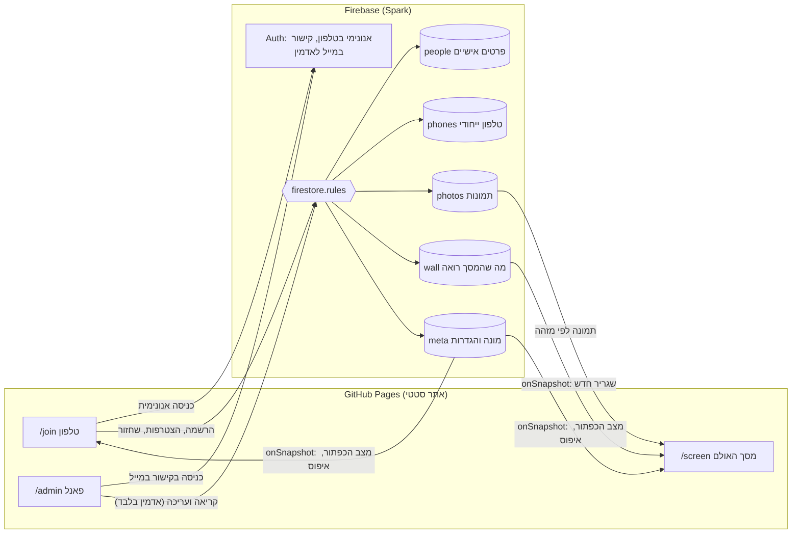

# מסמך אפיון טכני: נבחרת השגרירים

> גרסה 1.1 · 22.11.2026 · עבר מ-Supabase ל-Firebase (תוכנית Spark החינמית) · משלים את `docs/SPEC.md` (מה בונים) ומתאר איך בונים. ההדמיות ב-`docs/design/` הן נקודת המוצא לקוד של המסכים.

## 1. עקרונות

- **פשוט ובטוח לערב אחד.** כ-150 משתמשים, ערב אחד, צוות קטן. בוחרים טכנולוגיה מוכרת ומנוהלת, בלי שרת משלנו.
- **אין שרת ואין תשלום.** אתר סטטי מדבר ישירות עם Firebase בתוכנית Spark החינמית, בלי כרטיס אשראי. כל ההגנה יושבת בחוקי האבטחה של Firestore (`firestore.rules`), שהשרת של גוגל אוכף על כל קריאה וכתיבה.
- **פרטים אישיים לא יוצאים לציבור.** המסך והטלפונים מקבלים רק שם, יישוב ותמונה. טלפון ומייל נגישים רק לאדמין ולמי שנרשם.
- **המסך באולם לא נופל.** Firestore מתחבר מחדש לבד ושולח את המצב המלא, כך שאין "הודעות שהלכו לאיבוד".

## 2. טכנולוגיות

| שכבה | בחירה | למה |
|---|---|---|
| שפה | TypeScript | בדיקת טיפוסים בלי מחיר בזמן ריצה |
| בנייה | Vite, מצב multi-page | שלושה עמודים נפרדים, בנייה מהירה, פלט סטטי |
| ממשק | DOM ו-CSS נקיים, בלי פריימוורק | המסכים קטנים, והקיר הוא אנימציה מותאמת אישית שעובדת ישירות על אלמנטים (כמו בהדמיה) |
| מפה | `d3-geo` ו-`topojson-client`, רק בזמן בנייה | מפת ישראל ונקודות היישובים מחושבות מראש לקובץ JSON |
| צד שרת | Firebase, תוכנית Spark (חינמית) | Firestore (מסד נתונים עם עדכון חי), Authentication. בלי Storage ובלי Cloud Functions, שדורשים תוכנית בתשלום |
| לקוח | `firebase` v12 (מודולרי) | |
| אחסון האתר | GitHub Pages, פריסה עם GitHub Actions | חינמי, נפרס אוטומטית מכל מיזוג ל-main |
| בדיקות | Vitest (לוגיקה), בדיקות חוקי אבטחה מול ה-Firestore Emulator, Playwright (מסלול מלא), סקריפט עומס | |

גופנים: Heebo ו-Frank Ruhl Libre, נשמרים בריפו (self-hosted) כדי שהמסך לא יהיה תלוי ב-Google Fonts בזמן האירוע.

**מגבלות התוכנית החינמית מול הצורך:** 50 אלף קריאות ו-20 אלף כתיבות ביום, 1GB אחסון. 150 משתתפים עם תמונה של כ-100KB הם כ-15MB, ומסך שטוען את כל הקיר הוא כמה מאות קריאות. אם נחרוג, Firestore פשוט מסרב עד מחר ולא מחייב, כי אין כרטיס מחובר.

## 3. ארכיטקטורה



### זרימת ההצטרפות, מקצה לקצה

1. הטלפון מריץ טרנזקציה אחת: קורא את `meta/counter`, מגדיל אותו באחד, כותב `join_seq` לרשומה שלו ב-`people`, ויוצר `wall/{seq}` עם השם, היישוב ומזהה התמונה.
2. חוקי האבטחה מאשרים רק אם שלושת השינויים מתאימים זה לזה, הכפתור פתוח, והטלפון הוא הבעלים של הרשומה. לחיצה חוזרת לא משנה כלום.
3. המסך מאזין ל-`wall` ומקבל את השורה החדשה תוך פחות משנייה, מכניס אותה לתור ומציג.
4. אחרי ניתוק Firestore מתחבר מחדש ושולח את מה שהשתנה, בלי קוד שחזור מיוחד.

## 4. מבנה הריפו

```
/
├─ index.html             → הפניה ל-/join
├─ join/index.html        → מסכי הטלפון
├─ screen/index.html      → מסך האולם
├─ admin/index.html       → פאנל האדמין
├─ src/
│  ├─ shared/             → חיבור Firebase, api (הרשמה, הצטרפות, שחזור), טיפוסים, נרמול טלפון
│  ├─ join/               → טופס, מצלמה, חיתוך תמונה, אחסון מקומי
│  ├─ screen/             → layout של הטבעות, אנימציות, תור, מפה, אורות, חיבור
│  └─ admin/              → טבלה, עריכה, שליטה, ייצוא CSV
├─ public/
│  ├─ brand/              → לוגואים, גופנים
│  └─ geo/                → israel.json (נתיב המפה), cities.json (יישובים וקואורדינטות)
├─ scripts/
│  ├─ build-geo.ts        → מייצר את קובצי ה-geo מ-Natural Earth ומרשימת היישובים
│  ├─ load-test.ts        → 150 הרשמות והצטרפויות מקבילות
│  └─ purge-photos.ts     → מחיקת תמונות אחרי האירוע
├─ firestore.rules       → כל חוקי האבטחה
├─ firebase.json         → הגדרות Firebase והאמולטור
├─ tests/
│  ├─ unit/               → Vitest
│  └─ rules/              → חוקי האבטחה מול האמולטור
└─ docs/                  → SPEC, TECH, הדמיות
```

## 5. מודל הנתונים

### `people/{pid}`

`pid` הוא `sha256("betvuna|" + טלפון + "|" + מייל)`. כך מי שיודע את הטלפון ואת המייל יכול לשחזר את הרשומה מטלפון אחר, ואף אחד אחר לא יכול אפילו לנחש איפה היא.

| שדה | הערות |
|---|---|
| `full_name` | 2 עד 60 תווים |
| `phone` | מנורמל ל-`+9725XXXXXXXX` |
| `phone_hash` | `sha256(phone)`, מקשר ל-`phones` |
| `email` | באותיות קטנות |
| `city` | שם יישוב מתוך `cities.json` |
| `photo_id` | מזהה ב-`photos`, או null |
| `owners` | רשימת ה-uid של הטלפונים שנרשמו או שחזרו (עד 5) |
| `registered_by` | `pid` של מי שרשם אותו מהטלפון שלו |
| `consent_at`, `created_at` | זמן השרת |
| `join_seq` | המספר על הקיר, או null |

### `phones/{sha256(phone)}`

`{ pid }`. נוצר יחד עם הרשומה. אם הוא כבר קיים, ההרשמה נדחית, וכך טלפון נרשם פעם אחת. אף אחד חוץ מהאדמין לא קורא אותו.

### `photos/{uuid}`

`{ data, uid, created_at }`. `data` הוא JPEG ב-base64 (`data:image/jpeg;base64,...`), עד כ-300KB. התמונה נשמרת בתוך מסד הנתונים כי Storage דורש תוכנית בתשלום. 600×600 באיכות 0.82 יוצא בערך 100KB, הרבה מתחת למגבלה של 1MB למסמך.

### `wall/{seq}`

`seq`, `pid`, `full_name`, `city`, `photo_id`, `joined_at`, `is_simulated`, `hidden`. זה כל מה שהמסך רואה. אין בו טלפון ואין בו מייל.

### `meta/counter`, `meta/settings`

`{ next }`: המספר הבא על הקיר. `{ join_open, wall_epoch }`: הכפתור פתוח או נעול, ומספר האיפוס.

### `admins/{email}`

רשימת המורשים. מנוהלת ידנית מהקונסולה, אף אחד לא כותב אליה מהאתר.

## 6. הרשאות (`firestore.rules`)

| מי | מה מותר |
|---|---|
| כולם, גם בלי כניסה | לקרוא את `wall`, את `meta`, ותמונה לפי מזהה (לא לרשום את כל התמונות) |
| טלפון (כניסה אנונימית) | ליצור רשומה שהוא הבעלים שלה, ולהעלות תמונה |
| בעל הרשומה | לקרוא אותה, לשנות שם, יישוב ותמונה, ולהצטרף לקיר (טרנזקציה אחת עם המונה ושורת הקיר) |
| מי שיודע טלפון ומייל | להוסיף את עצמו כבעלים ("כבר נרשמתי"), עד 5 טלפונים |
| אדמין (מייל מאומת שנמצא ב-`admins`) | לקרוא ולכתוב הכל |

החוקים בודקים גם את התוכן: אורך שם ויישוב, פורמט טלפון ומייל, ש-`pid` באמת מחושב מהטלפון והמייל, שהזמנים הם זמן השרת, ושהתמונה היא JPEG בגודל סביר.

**בלי מגבלת קצב.** בתוכנית החינמית אין קוד בצד השרת. מי שמנסה להציף יכול ליצור רשומות מזויפות, אבל לא לראות או לשנות רשומות של אחרים, והאדמין מוחק. לערב סגור של 100 בוגרים זה מקובל. אם יידרש, מוסיפים App Check.

**הסיכון של השחזור:** מי שיודע גם את הטלפון וגם את המייל של מישהו יכול לצרף אותו לנבחרת. האדמין יכול להסיר.

## 7. עדכון חי

- **המסך:** `onSnapshot` על `wall` (ממוין לפי `seq`) ועל `meta/settings`. בטעינה מקבלים את כל הקיר, ואחר כך רק שינויים. שורה חדשה נכנסת לתור, שורה שהוסתרה יוצאת מהקיר, ושינוי ב-`wall_epoch` מנקה את המסך.
- **הטלפונים:** מאזינים רק ל-`meta/settings`, כדי שהכפתור ייפתח לבד כשהוא נעול.
- **"המסך מחובר" באדמין:** המסך כותב פעימה (`meta/screen.last_seen`) כל 20 שניות, והאדמין מציג ירוק אם הפעימה האחרונה מלפני פחות מדקה. (Firestore לא נותן presence מובנה.)
- **עומס:** Firestore לא מגביל מספר מאזינים בתוכנית החינמית בצורה שנגיע אליה.

## 8. מסך הטלפון: פרטים טכניים

- **זיהוי:** הטלפון נכנס אנונימית ל-Firebase (ה-uid נשמר בדפדפן), ושומר ב-`localStorage` את רשימת ה-`pid` שנרשמו ממנו (אפשר כמה משתתפים בטלפון אחד). אם הדפדפן נמחק, "כבר נרשמתי" עם טלפון ומייל משחזר.
- **מצלמה:** `getUserMedia` עם המצלמה הקדמית ומסגרת עגולה. אם אין הרשאה או אין תמיכה, עוברים ל-`<input type="file" accept="image/*" capture="user">`, שעובד בכל טלפון.
- **עיבוד תמונה בטלפון:** `createImageBitmap` עם תיקון סיבוב, חיתוך לריבוע ממורכז, הקטנה ל-600×600, JPEG באיכות 0.82 (בערך 80 עד 120KB), ושמירה כ-base64 ב-`photos`. אם יצא מעל 300KB, מורידים איכות עד שנכנס.
- **יישובים:** `cities.json` נטען פעם אחת (בערך 1,200 יישובים, כ-40KB) ומשמש להשלמה האוטומטית.
- **רטט:** `navigator.vibrate` במסך "ברוך הבא", כשהדפדפן תומך (אנדרואיד).
- **טלפון:** נרמול של `05X-XXXXXXX`, `+972` ו-`972` לפורמט אחד בטלפון, וחוקי האבטחה מוודאים את הפורמט.

## 9. מסך האולם: פרטים טכניים

- **בסיס הקוד:** ההדמיה `docs/design/wall-demo.html` מפורקת למודולים: `layout` (חישוב הטבעות), `queue` (תור ההופעות), `settle` (אנימציית הכבידה), `map`, `lights`, `connection`.
- **חישוב הטבעות:** פונקציה טהורה `layoutRings(n, width, height) → slots[]`, עם בדיקות יחידה. כל טבעת חייבת להיכנס במלואה למסך, והחלק העליון מוסתר רק על ידי הכותרת.
- **ביצועים:** תנועה עם `transform` ולא עם `left/top`, כדי שהדפדפן ישתמש בכרטיס הגרפי. תמונות נטענות מראש (`decode()`) לפני שמופיעות בזרקור. יעד: 60 פריימים לשנייה עם 100 עיגולים.
- **תור:** הופעה אחת בכל פעם. זמן הזרקור מתקצר מ-1.6 שניות עד 0.45 שנייה ככל שהתור מתארך.
- **מסך מלא ומניעת כיבוי:** כפתור "התחל הקרנה" שעושה `requestFullscreen` ו-`navigator.wakeLock`, ומסתיר את הסמן.
- **מצב חזרה:** `?demo=1` מריץ סימולציה מקומית בלי שרת, לחזרות ולבדיקת המקרן.
- **רזולוציה:** הכל ביחידות יחסיות לגובה ולרוחב, כך שזה נראה אותו דבר ב-1080p וב-4K.

## 10. פאנל האדמין: פרטים טכניים

- **כניסה:** Firebase Authentication עם קישור במייל (Email link). מי שהמייל שלו לא ב-`admins` רואה "אין הרשאה", וחוקי האבטחה חוסמים אותו בכל מקרה.
- **רשימה:** `onSnapshot` על `people`, מותר רק לאדמין.
- **ייצוא CSV:** נוצר בדפדפן, UTF-8 עם BOM כדי שאקסל יקרא עברית, בלי שגרירים מדומים.
- **איפוס:** מחייב להקליד "אפס". מוחק את שורות `wall`, מאפס את `join_seq` של כולם ואת המונה, ומעלה את `wall_epoch`, ב-batch אחד.
- **סימולציה:** האדמין כותב שורות `wall` עם `is_simulated: true` ישירות.
- **רישום ידני:** אותו טופס כמו בטלפון, עם צילום ממצלמת המחשב או העלאת קובץ.

## 11. פריסה וסביבות

- **Firebase:** פרויקט אחד בתוכנית Spark, בלי כרטיס אשראי. החוקים בריפו (`firestore.rules`) ומועלים עם `firebase deploy --only firestore:rules`. הגדרות האפליקציה (apiKey וכו') ציבוריות מטבען ונשמרות כמשתני ריפו ב-GitHub.
- **GitHub Actions:** בכל PR: בדיקות יחידה, בדיקות חוקי האבטחה מול האמולטור, ובנייה. בכל מיזוג ל-main: בנייה ופריסה ל-GitHub Pages.
- **כתובות:** `/join` (מקוד ה-QR), `/screen`, `/admin`. קוד ה-QR נוצר מראש כקובץ להדפסה.
- **שמירת נתונים:** תמונות נמחקות ב-2.2.2027 עם `scripts/purge-photos.ts`. פרטי הקשר נשמרים.

## 12. בדיקות

| סוג | מה נבדק |
|---|---|
| יחידה (Vitest) | נרמול טלפון, `layoutRings` (אין חפיפות, כל טבעת בתוך המסך, עד 150), תור ההופעות, ייצוא CSV |
| חוקי אבטחה (אמולטור) | זרים לא קוראים טלפון ומייל, הצטרפות פעם אחת ובמספר רציף, אי אפשר לכתוב לקיר או למונה ישירות, שחזור עם מייל נכון בלבד, תמונות JPEG בלבד |
| מסלול מלא (Playwright) | הרשמה עם תמונה, הצטרפות, הופעה על המסך תוך 2 שניות, הסתרת תמונה מהאדמין |
| עומס | `scripts/load-test.ts`: 150 הרשמות ואז 150 הצטרפויות בתוך 30 שניות. המסך מציג את כולן, בלי כפילויות ובלי חורים |
| ידני | אייפון ואנדרואיד (ספארי, כרום, דפדפן וואטסאפ), המקרן באולם, ניתוק אינטרנט באמצע |

## 13. סדר הבנייה

| תאריך | שלב | תוצר |
|---|---|---|
| 23.11 | תשתית | ריפו עם Vite ו-TypeScript, פריסה ל-Pages, פרויקט Firebase, חוקי אבטחה עם בדיקות, קובצי geo |
| 24–25.11 | הטלפון | ששת המסכים, מצלמה ועיבוד תמונה, הרשמה, הצטרפות ושחזור |
| 25–27.11 | מסך האולם | פירוק ההדמיה לקוד, חיבור ל-Realtime, תור, שחזור מניתוק, מסך מלא |
| 27–28.11 | אדמין | כניסה, טבלה, עריכה ותמונות, שליטה, סימולציה, איפוס, ייצוא |
| 28–29.11 | הקשחה | בדיקת עומס, בדיקות במכשירים, מצב חזרה, קוד QR |
| 30.11–1.12 | חזרה גנרלית | על המקרן באולם, עם טלפונים של הצוות |
| 2.12 | האירוע | |

כל שלב נבנה ב-PR נפרד ונפרס מיד, כך שאפשר לבדוק בטלפון כבר מהיום השני.

## 14. סיכונים

| סיכון | מה עושים |
|---|---|
| Wi-Fi באולם חלש | המשתתפים על סלולר, תמונות קטנות, למחשב ההקרנה נקודה חמה כגיבוי ושחזור אוטומטי |
| הרבה לוחצים באותה שנייה | תור הופעות מתקצר, `join_seq` מסודר מהשרת, בדיקת עומס מראש |
| דפדפן מובנה של וואטסאפ או אינסטגרם חוסם מצלמה | חזרה ל-`input type=file`, שעובד שם |
| חריגה ממכסה יומית של התוכנית החינמית | רחוק מאוד מהצורך. מסך האולם לא טוען את הקיר מחדש בלולאה, ובודקים את הצריכה בחזרה הגנרלית |
| תמונה לא ראויה | הסתרה מיידית מהאדמין |
| מחשב ההקרנה נכבה או נרדם | Wake Lock, הגדרות חשמל, ושחזור מלא בטעינה מחדש |

## 15. מה נדרש כדי להתחיל

- **פרויקט Firebase** בתוכנית Spark, עם אפליקציית ווב, Firestore, וכניסה אנונימית וכניסה בקישור במייל.
- **GitHub Pages:** הפעלה בהגדרות הריפו (Source: GitHub Actions).
- **כתובות מייל של האדמינים** (התקבלו, נכנסות ל-`admins` מהקונסולה ולא לריפו).

